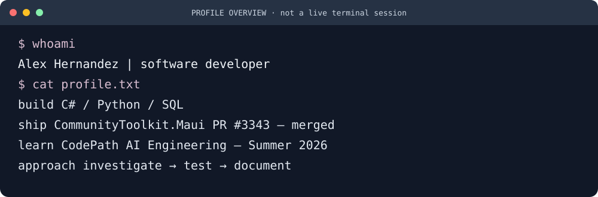

[README.md](https://github.com/user-attachments/files/35100645/README.md)
<!-- Layout inspired by the supplied README template by Daria Stanilevici.
     Alex-specific writing and visual assets adapted for this profile. -->

# Alex Hernandez
### Software development · Open source · Data quality

<rect width="1000" height="330" rx="14" fill="#111827"/><path d="M14 0H986Q1000 0 1000 14V42H0V14Q0 0 14 0" fill="#263244"/><circle cx="22" cy="21" r="6" fill="#F87171"/><circle cx="44" cy="21" r="6" fill="#FBBF24"/><circle cx="66" cy="21" r="6" fill="#86EFAC"/><text x="500" y="26" text-anchor="middle" fill="#CBD5E1" font-family="monospace" font-size="13">PROFILE OVERVIEW · not a live terminal session</text><text x="30" y="80" fill="#D9BED1" font-family="monospace" font-size="20">$ whoami</text><text x="30" y="114" fill="#F1F5F9" font-family="monospace" font-size="20">Alex Hernandez | software developer</text><text x="30" y="148" fill="#D9BED1" font-family="monospace" font-size="20">$ cat profile.txt</text><text x="30" y="182" fill="#E2E8F0" font-family="monospace" font-size="20">build     C# / Python / SQL</text><text x="30" y="216" fill="#E2E8F0" font-family="monospace" font-size="20">ship      CommunityToolkit.Maui PR #3343 — merged</text><text x="30" y="250" fill="#E2E8F0" font-family="monospace" font-size="20">learn     CodePath AI Engineering — Summer 2026</text><text x="30" y="284" fill="#E2E8F0" font-family="monospace" font-size="20">approach  investigate → test → document</text></svg>
<svg xmlns="http://www.w3.org/2000/svg" width="1200" height="110" viewBox="0 0 1200 110"><g transform="translate(1200 110) rotate(180)"><path fill="#D9BED1" d="M0 0H1200V45C900 135 650 5 360 65S100 95 0 70Z"/></g></svg>
<svg xmlns="http://www.w3.org/2000/svg" width="1200" height="110" viewBox="0 0 1200 110"><path fill="#D9BED1" d="M0 0H1200V45C900 135 650 5 360 65S100 95 0 70Z"/></svg>ing-svg.herokuapp.com?font=Montserrat&amp;weight=500&amp;size=22&amp;duration=3500&amp;pause=1200&amp;color=8B6F95&amp;center=true&amp;width=680&amp;lines=Hi%2C+I%27m+Alex+Hernandez;C%23+and+Python+%7C+Open-source+contributor;Investigate.+Build.+Test.+Document." alt="Alex Hernandez — C# and Python, open-source contributor" width="680" />

**I investigate defects, build useful tools, and document how I know they work.**

Pomona, California · English & Spanish

> **Start here:** [Merged code contribution](https://github.com/CommunityToolkit/Maui/pull/3343) · [Engineering portfolio](https://github.com/alexh30486-ui/ai301-coursework/blob/main/beat-3-portfolio/toolkit-portfolio.md) · [Verified certificate](https://certificates.codepath.org/2b9fc651-1961-4145-a8c0-07a98da56abf.pdf)

---

## 👋 A little about me

I’m Alex, a software developer with a background in operations leadership. I work with C#, Python, SQL, and developer tools, with a particular interest in debugging, data quality, and making technical work easier to review.

At Amazon, I coordinated operational work and used performance data to understand bottlenecks. In my software projects, I bring that same attention to where a process breaks, what needs to change, and how to check the result.

My work here includes a merged open-source code fix, coursework on AI-assisted development, and independent tools. I keep those categories distinct so you can see what I contributed and where each project stands.

## 🔎 A contribution you can inspect

### CommunityToolkit.Maui — fixing initialization order

**C# · .NET · Roslyn · Regression testing**

The code-fix provider placed `.UseMauiCommunityToolkit()` after `.Build()`. Existing analyzer tests checked diagnostic behavior but did not exercise the generated edit.

I added a failing regression test, corrected syntax-node selection using the diagnostic span, and verified that the corrected test project passed all **17 tests**. The focused, two-file contribution was reviewed and merged on **October 10, 2026**.

| Problem | Change | Verification |
| --- | --- | --- |
| Initialization was inserted after `.Build()` | Select the invocation identified by the diagnostic span | A generated-source regression test catches the incorrect ordering |
| Existing tests did not apply this code fix | Add a test exercising the analyzer and provider together | Corrected project: 17 passing tests |
| Reviewers needed a clear account of the change | Document scope, before/after results, and check limitations | Public issue discussion and merged PR |

[**Read PR #3343 →**](https://github.com/CommunityToolkit/Maui/pull/3343) · [Issue #879](https://github.com/CommunityToolkit/Maui/issues/879) · [Contribution story](https://github.com/alexh30486-ui/ai301-coursework/blob/main/beat-2-contribution/contribution-story.md)

<strong>What this result establishes—and what it doesn’t</strong>

The regression compares generated source and verifies the exercised placement defect. It is not a separate compilation test of every generated snippet or proof that every possible invocation shape is covered. The 17-test result applies to the analyzer test project, not the entire MAUI platform matrix.

## 🛠️ Selected work

### Developer Workflow Toolkit
**Coursework · Python · Git · GitHub CLI · Bash**

I configured and adapted four supplied tools to support the contribution workflow:

| Tool | Job | A concrete lesson from using it |
| --- | --- | --- |
| **Issue scout** | Find and evaluate candidate issues | A starter label cannot replace a concrete deliverable; I tightened a rule after a vague issue passed |
| **Voice guard** | Check communication drafts against configured rules | A claim needs supporting evidence in the same message |
| **Ship gate** | Check the submission package and configured repository commands | Passing commands did not override evidence tied to an earlier commit |
| **PR-monitor** | Read PR state and draft a possible next move | A suggested follow-up still needs human judgment about the thread’s actual state |

The scout and monitor runs documented in the portfolio were retrospective. They did not guide the earlier Maui issue selection or original fix. My work includes configuration, evaluation, and documented revisions; the supplied tool implementations are credited in the portfolio.

[**Explore the toolkit portfolio →**](https://github.com/alexh30486-ui/ai301-coursework/blob/main/beat-3-portfolio/toolkit-portfolio.md)

### Data Quality Toolkit
**Independent project · Python · pandas · scikit-learn · In development**

A reusable CSV inspection and cleaning toolkit with explicitly configured rules for missing values, duplicate records, inconsistent formatting, numeric validity, and timestamp freshness.

- Preserve identifiers such as `00123` during CSV ingestion.
- Separate profiling from configured cleaning actions.
- Record input hashes, configuration, and affected records in reports.
- Check behavior using synthetic inputs, including empty datasets, all-null columns, text-only tables, and timezone-aware timestamps.

Current hardening work focuses on protecting earlier output files and rejecting invalid configuration keys. This is an evolving project, not a production-readiness claim.

## 💻 Tech stack

Tools used across my contributions, coursework, and independent projects. The linked work above provides context for how I use them.

**Languages**

**Backend and data**

**Development and automation**

## 🎓 Education & credential

**University of California, San Diego**  
Bachelor of Arts in Communication · 2021

**CodePath Applications of AI Engineering — Certificate of Achievement**  
Awarded to **Alex Hernandez**, **Summer 2026** · Certificate ID **429811**

[**View the certificate →**](https://certificates.codepath.org/2b9fc651-1961-4145-a8c0-07a98da56abf.pdf)

**Additional coursework:** CodePath AI301 Open Source Capstone · Fall 2026. The summer certificate and fall contribution portfolio represent separate course work.

## 🧭 How I work

- **Start with the failure.** Describe the expected behavior and capture what actually happens.
- **Keep the change focused.** Connect each code change to the problem being solved.
- **Check the intended revision.** Evidence from an earlier commit may not support the version being submitted.
- **Use AI with review.** I use AI assistance for investigation, drafting, and development, then inspect outputs and document limitations.
- **Make the result inspectable.** Link to code, tests, and the reasoning behind decisions.

## 📚 Engineering notes

My public write-ups explain the work behind the code: the failure I investigated, the change I made, the checks I ran, and what the results do not prove.

- [**Contribution story:** the Maui defect, regression test, and review](https://github.com/alexh30486-ui/ai301-coursework/blob/main/beat-2-contribution/contribution-story.md)
- [**Toolkit portfolio:** configurations, friction, evidence, and follow-up decisions](https://github.com/alexh30486-ui/ai301-coursework/blob/main/beat-3-portfolio/toolkit-portfolio.md)

## 📊 GitHub stats

<strong>Activity and repository language cards</strong>

These third-party cards are supplementary activity summaries. Language proportions reflect repository contents, not proficiency, and the cards may be unavailable when their providers are down.

## 🤝 Connect

Interested in discussing software development, developer tooling, data quality, or an open-source contribution?

[**Email me**](mailto:alexgioherz@gmail.com) · [**Browse my repositories**](https://github.com/alexh30486-ui?tab=repositories) · [**Read my contribution story**](https://github.com/alexh30486-ui/ai301-coursework/blob/main/beat-2-contribution/contribution-story.md)

> [!TIP]
> **Reviewing my work for a role?** Start with the merged PR for a concrete code change, then read the portfolio for how I investigate, validate, and communicate. Contact me by email for my current résumé.

